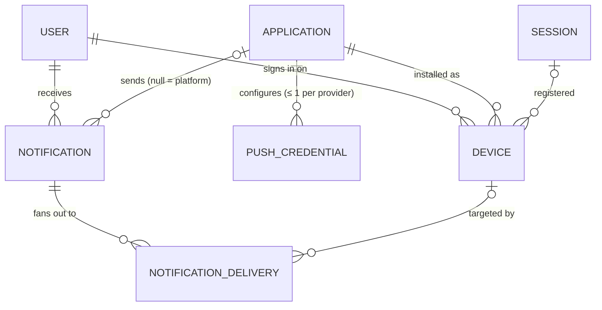

# Notifications
{: .no_toc }

The records behind push notifications and the notification inbox. See [API Reference → Push Notifications](../../api-reference/notifications/) for the endpoints and the delivery rules.
{: .fs-6 .fw-300 }

1. TOC
{: toc }

---

## Why these live in the hub

Every Application needs to reach its users with alerts and updates, and every one would otherwise build the same machinery: a table of device tokens, the APNs and FCM integrations, token cleanup, retries, a "what did I miss" list, and per-user mute switches. The hub already knows who the User is, which Applications they can reach, which session each install belongs to, and what they've muted (the `push` channel in [Settings](../settings/)). So the hub owns that machinery once, and an Application sends a notification with one API call.

What stays with the Application is what has to: its own provider credentials, because Apple and Google deliver only for the app a token was issued to, and the decision about what to say and when.

## Device

One install of one Application, on one device, signed in as one User, with the provider token that reaches it.

| Field | Type | Notes |
|---|---|---|
| `id` | string | `dvc_` prefix. |
| `user_id` | string | The User signed in on the install. |
| `application_id` | string | The Application the install belongs to. The same phone running two Applications is two Devices, because the OS issues each app its own token. |
| `provider` | enum | `apns` \| `fcm` \| `web_push`. |
| `environment` | enum, nullable | `production` \| `sandbox`. Set only for `apns`, where it picks Apple's production or development gateway. |
| `token_hint` | string | The last four characters of the token. The token itself (or, for `web_push`, the whole `PushSubscription`) is stored KMS-encrypted and never returned. |
| `name`, `app_version` | string, nullable | Labels the client supplies, for the User's own device list and for support. |
| `session_id` | string, nullable | The [Session](../users-and-organizations/#session) that registered the device. Revoking that session deactivates it. `null` when an app key registered it. |
| `status` | enum | `active` \| `inactive`. Only `active` devices are sent to. |
| `inactive_reason` | enum, nullable | Set exactly when `status` is `inactive`: `unregistered` (the provider reported the token gone), `session_revoked`, `user_suspended`, `user_deleted`, `test_user_expired` (a test-mode User's `expires_at` passed), `stale` (not re-registered for 270 days), `limit` (displaced by a 21st device), or `credential_removed` (a `web_push` device whose VAPID key was deleted). |
| `last_registered_at` | timestamp | The latest registration or refresh. |
| `last_delivery_at` | timestamp, nullable | The latest delivery a provider accepted. |
| `test_mode` | boolean | |
| `created_at`, `updated_at` | timestamp | |

A Device is identified by its token, not by anything the client chooses: one Device per (Application, provider, token) and mode. Registering a token again refreshes the same Device. Registering it as a different User replaces the Device, so one User's device history never passes to the next person to sign in on that install.

### Example

```json
{
  "id": "dvc_01JAH2B3C4D5E6F7G8H9J0K1M2",
  "user_id": "usr_01JAG3Z9X8QS3F6K2M4N5P6R7S",
  "application_id": "app_timetrack",
  "provider": "apns",
  "environment": "production",
  "token_hint": "…9f3a",
  "name": "Jordan's iPhone",
  "app_version": "2.4.0",
  "session_id": "ses_01JAG8K4Q9R0S1T2V3V4W5X6Y8",
  "status": "active",
  "inactive_reason": null,
  "last_registered_at": "2026-10-17T15:05:00Z",
  "last_delivery_at": "2026-10-17T15:10:02Z",
  "test_mode": false,
  "created_at": "2026-10-17T15:05:00Z",
  "updated_at": "2026-10-17T15:10:02Z"
}
```

### Lifecycle

```
 register (POST) ──► active ──── logout / session revoked ──────────► inactive
                       ▲    ├─── provider reports token gone ──────►    │
                       │    ├─── user suspended or deleted ────────►    │
                       │    ├─── 270 days without re-registering ──►    │
                       │    └─── displaced by a 21st device ───────►    │
                       │                                                │
                       └──────── re-register the same token ◄───────────┤
                                                                        ▼
                                          deleted: DELETE, the token registered by another User,
                                          or 30 days after deactivation
```

## PushCredential

An Application's credential for one push provider. Configuration, not per-user data: like the [Application](../applications/) row it belongs to, it's shared by test and live mode.

| Field | Type | Notes |
|---|---|---|
| `id` | string | `pcr_` prefix. Addressed in the API by `provider` (`/applications/{id}/push-credentials/{provider}`), since there's at most one per provider. The id is what Audit Events reference. |
| `application_id` | string | |
| `provider` | enum | `apns` \| `fcm` \| `web_push`. Unique per Application. |
| `team_id`, `key_id`, `topic` | string | APNs only. `topic` is the app's bundle id. |
| `project_id`, `client_email` | string | FCM only, read from the service account. |
| `subject`, `vapid_public_key` | string | Web Push only. The platform generates the VAPID key pair. The public key is what a web client subscribes with. |
| *(secret)* | write-only | The APNs `.p8` key, the FCM service-account JSON, or the VAPID private key. KMS-encrypted at rest, never returned, never in an Audit Event. |
| `status` | enum | `active` \| `failed`. `failed` when the provider rejects the credential itself. Sends to that provider skip until it's fixed. |
| `failure_reason`, `failed_at` | string / timestamp, nullable | The provider's reason code and when it failed. |
| `last_used_at` | timestamp, nullable | |
| `created_at`, `updated_at` | timestamp | |

Managed only by a person (the Application's owner, or `applications.manage`), never by an API Key, the same rule as [API Keys](../../api-reference/api-keys/#endpoints): it's a credential, and credentials are managed by people. Every create, change, and removal is audited.

## Notification

One message to one User, from one Application or from the platform. It's both the unit of sending and the inbox item.

| Field | Type | Notes |
|---|---|---|
| `id` | string | `ntf_` prefix. |
| `user_id` | string | The recipient. |
| `application_id` | string, nullable | The sending Application. `null` for a platform alert. |
| `source` | enum | `application` \| `platform`. `platform` exactly when `application_id` is `null`. |
| `category` | string | What kind of notification it is, in the sender's own vocabulary (`timesheet.reminder`). `security.`, `account.`, and `billing.` are reserved for the [platform catalog](../../api-reference/notifications/#platform-alerts). |
| `priority` | enum | `normal` \| `high`. |
| `title`, `body` | string | `body` is nullable. |
| `data` | object | Up to 20 string → string pairs, delivered with the push and kept with the inbox item. |
| `action_url` | string, nullable | Where opening it takes the User. |
| `badge`, `sound`, `collapse_key`, `ttl_seconds` | | Push presentation and delivery hints. See [Sending a notification](../../api-reference/notifications/#post-usersidnotifications). |
| `push` | object | `requested`, `status` (`queued` \| `sent` \| `failed` \| `skipped`), `devices_targeted`, `devices_sent`, `devices_failed`, and `skip_reason`. A summary of the deliveries below. |
| `state` | enum | `unread` \| `read` \| `archived`, derived from `read_at` and `archived_at`. |
| `read_at`, `archived_at` | timestamp, nullable | |
| `sender` | object | `{ "type": "api_key" \| "user" \| "system", "id": … }`, the same actor shape as an [Audit Event](../orders-and-audit/#audit-event). |
| `test_mode` | boolean | |
| `created_at`, `updated_at` | timestamp | |

Kept for **90 days**, then deleted by a nightly job, whatever its state. The inbox is a recent-activity list, not an archive. Sending a notification is not an Audit Event: it changes no access, and the Notification row, with its `sender`, is already the record of who sent what.

### NotificationDelivery

One attempt to reach one Device with one Notification: the outbox row a worker picks up, and the per-device result afterwards.

| Field | Type | Notes |
|---|---|---|
| `id` | string | `ndl_` prefix. |
| `notification_id` | string | |
| `device_id` | string, nullable | `null` once the Device is deleted. |
| `provider` | enum | Copied from the Device when the delivery is created. |
| `status` | enum | `pending` \| `sent` \| `failed` \| `skipped`. |
| `attempts` | integer | 0–4. |
| `error` | string, nullable | The provider's reason code (`BadDeviceToken`, `UNREGISTERED`, …) or `timeout`. |
| `sent_at` | timestamp, nullable | When the provider accepted it. |

Deliveries are written in the same transaction as their Notification, one per Device eligible at that moment, so a committed send can't lose its push. They're kept for 30 days.

## How they relate



## Privacy and retention

Device tokens, notification content, and delivery results are personal data:

- [`GET /users/{id}/export`](../../api-reference/users/#get-usersidexport) includes the User's devices (without tokens) and their notifications.
- The [hard-delete cascade](../../non-functional-requirements/#hard-delete-cascade) deletes every Device, Notification, and NotificationDelivery of the User.
- A soft-delete or suspension deactivates the User's devices right away, so nothing is pushed to a closed or suspended account.

The payload of every push passes through Apple, Google, or a browser vendor's push service, which is why [Compliance](../../compliance/#gdpr-and-ccpa--build-for-it-now) lists them as sub-processors, and why senders should keep sensitive content out of the title, body, and data.

Building the tables? See [Database Schema → Push notifications](../database-schema/#push_credentials-devices-notifications-notification_deliveries).
