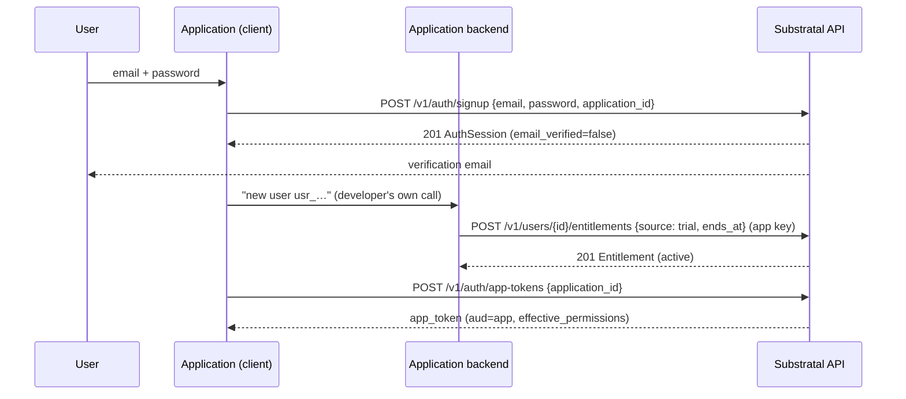
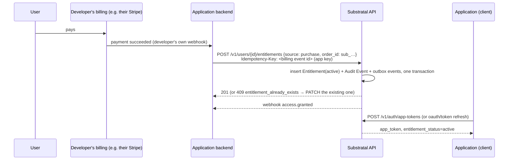
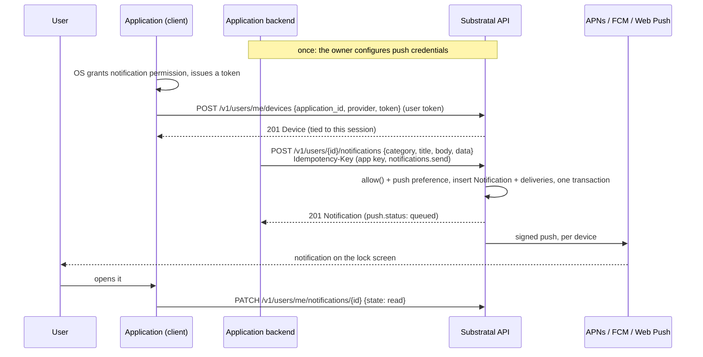

# Workflows
{: .no_toc }

End-to-end sequences across the resources in the [API Reference](../api-reference/). If you're adding a feature, check here first. It's probably a step inside one of these, not a new flow.
{: .fs-6 .fw-300 }

1. TOC
{: toc }

---

## End user signs up inside an app (embedded login)

The common first-contact path: someone downloads a developer's app and creates an account from inside it.



1. The app calls [`POST /v1/auth/signup`](../api-reference/auth/#post-v1authsignup). The User, Profile, Settings, and `member` Role are created in one transaction, and the app gets a session immediately.
2. Signup grants nothing. **The developer decides** whether this user gets the app: free tier, trial, or nothing until they pay. Their backend grants an [Entitlement](../api-reference/entitlements/#post-v1usersidentitlements) with its app-scoped [API Key](../api-reference/api-keys/#app-confined-permissions).
3. The app exchanges the platform session for an [app token](../api-reference/auth/#post-v1authapp-tokens) and verifies it locally from then on. The user's [AppProfile](../api-reference/profiles/) and [AppSettings](../api-reference/settings/) read as defaults until the app first writes them.

## Purchase → access

Someone pays the *developer* for their app. Substratal never sees the payment; the developer's backend reflects the outcome.



1. The developer's own billing system (see [Orders & Audit → Billing system of record](../domain-model/orders-and-audit/#billing-system-of-record)) tells the developer's backend that a payment succeeded.
2. The backend calls `POST /v1/users/{id}/entitlements` with `source: purchase`, its own subscription id as `order_id`, and its billing event id as the `Idempotency-Key`. A retried billing event can never double-grant.
   - If the user already holds a `trial`, the backend `PATCH`es it instead: `{"source": "purchase", "order_id": "sub_…", "ends_at": null}`.
   - If the user holds a `disabled` row, the backend sets it back to `active`.
3. The Entitlement, its Audit Event, and its webhook events commit together. `entitlement.granted` and `access.granted` go to the app's subscriptions.
4. The next app token or introspection call reflects `active`.

**Reverse direction:** a refund or a lapsed subscription on the developer's side becomes `PATCH /v1/entitlements/{id}` `{"status": "revoked", "disabled_reason": "refunded"}`. A lapse at period end can also be modeled up front by setting `ends_at`, in which case the hub expires it automatically. Find the row with `GET /v1/entitlements?order_id=sub_…`.

## Admin turns an app off for a user

The "kill switch": a support agent or admin disabling one user's access to one app, without touching anything else about their account.

1. `PATCH /v1/entitlements/{id}` with `{"status": "disabled", "disabled_reason": "..."}`, ideally with `If-Match`.
2. In one transaction, the hub writes an [Audit Event](../domain-model/orders-and-audit/) (`entitlement.disabled`, with actor, before/after, and reason) and enqueues webhook events.
3. The hub emits `entitlement.disabled` and, if this was the user's only active path to the app, `access.revoked` (reason `entitlement_disabled`).
4. The app, subscribed to `access.revoked` as it's [required to be](../trust-model/#how-fast-does-revocation-need-to-land), force-expires the user's local session immediately. The app token's 5-minute TTL is only the backstop.
5. Nothing about the user's Role assignments, Profile, or Settings for that app changes. Re-enabling (`{"status": "active"}`) restores exactly what was there before, and fires `access.granted`.

## User is suspended

1. `POST /v1/users/{id}/suspend` (`users.manage`).
2. Every hub session is revoked. Platform tokens stop working on their next request, and refresh fails.
3. `access.revoked` (reason `user_suspended`) fires for **every** Application the user had active access to, and `user.suspended` fires to subscribers.
4. Entitlements are untouched. `PATCH {"status": "active"}` reactivates the user and fires `access.granted` for each app they still have.

## Role change

1. An admin, the app's owner, or the app's own key calls `POST /v1/users/{id}/roles/{roleId}` (assign) or `DELETE` (remove).
2. `effective_permissions` for that user and that app changes immediately on the hub side.
3. The hub emits `role.assigned` / `role.removed`.
4. Downstream, an assignment is picked up at the next app token (at most 5 minutes) or introspection call. A **removal** must take effect immediately: `role.removed` is part of the required subscription set, and the app should drop the permission from the live session as soon as it arrives.

## New user, first app

1. An admin provisions the user: `POST /v1/users` creates the account (`invited` by default). A default Profile and Settings are created, the `member` platform Role is assigned, and an invitation email is sent.
2. An admin or the developer's backend grants an Entitlement (`admin_grant`, `trial`, or `purchase`). This is allowed while the user is still `invited`, and access starts once they activate.
3. The user accepts the invitation ([`POST /v1/auth/invitations/accept`](../api-reference/auth/#post-v1authinvitationsaccept)), setting a password, and is signed in.
4. The first time the app reads the user's AppProfile or AppSettings, it gets defaults. The first write creates the row. There's no "provision this user in this app" step to orchestrate.

## Team purchase (org-wide grant)

1. A customer creates an [Organization](../api-reference/organizations/#post-v1organizations) (self-service) and invites members by email. Each invitation is a `pending` membership until the person accepts it.
2. The customer pays the developer for a team plan. The developer's backend calls `POST /v1/organizations/{id}/entitlements` with its app key: `order_id`, and optionally `member_scope`.
3. Every included member gets access. `access.granted` fires once per member. New members are included automatically under `all_members`/`denylist` once they accept their invitation (a `pending` membership grants nothing).
4. Membership changes on the customer's side need no API call unless the developer limits seats with `member_scope: allowlist`. Billing per member is the developer's business.

## An org admin narrows who an org-wide grant reaches

1. An org admin (`OrganizationMembership.role: org_admin`) calls `PATCH /v1/entitlements/{id}` on their Organization's `org_seat` Entitlement, setting `member_scope: allowlist` or `denylist` and `member_overrides`.
2. The hub writes an [Audit Event](../domain-model/orders-and-audit/#audit-event) (`entitlement.member_scope_changed`). It's not `entitlement.disabled`/`entitlement.granted`, since the grant's own `status` didn't change.
3. Every affected member's resolved access is recomputed. Nothing is backfilled, because there's no per-member row to update. `access.revoked` (reason `org_grant_changed`) fires for each member who lost their only path, and `access.granted` for each who gained one. A member excluded this way keeps any separate, personally-sourced Entitlement to the same app. See [Access Control → Organization vs. User precedence](../access-control/#organization-vs-user-precedence).

## A User subscribes to Standard

1. On Free, the User already has every free Application. A standard one shows up in the catalog (`access_tier: standard`) but doesn't resolve to access.
2. Their client calls [`POST /v1/users/me/billing/checkout-sessions`](../api-reference/billing/#checkout) with `plan: standard` and the User's token, and sends them to the returned Stripe Checkout URL. The hub creates their [Subscription](../api-reference/billing/#the-subscription-object) as `incomplete` and writes `subscription.created`.
3. They pay. Stripe sends `checkout.session.completed` and `customer.subscription.created` to the hub's Stripe webhook. The hub re-reads the subscription from Stripe, sets it `active`, and writes `subscription.status_changed`.
4. In the same transaction, the platform grants the User a `source: subscription` Entitlement to each standard Application. Each writes `entitlement.granted` (actor `system`), and `access.granted` fires for every Application the User didn't already have.
5. The client polls [`GET /v1/users/me/subscription`](../api-reference/billing/#get-v1usersidsubscription) until `plan` is `standard`.
6. Later, they cancel in the Stripe Customer Portal. At period end Stripe reports `canceled`; the platform ends those Entitlements, `access.revoked` fires for each Application they no longer reach some other way, and the User is back on Free with their data intact.

## An Organization subscribes to Standard for its members

1. An org admin calls [`POST /v1/organizations/{id}/billing/checkout-sessions`](../api-reference/billing/#checkout) with `plan: standard` and a `member_scope`: `all_members`, or an `allowlist` / `denylist` with `member_overrides`. Checkout's quantity is the current covered-member count.
2. When Stripe reports the subscription active, the platform grants the Organization one org-wide `source: subscription` Entitlement per standard Application, with the subscription's member selection. `access.granted` fires once per covered member per Application.
3. Members who join later (once they accept) are covered automatically under `all_members` / `denylist`. Members who leave lose access through it at once.
4. To change who's covered, the org admin calls [`PATCH /v1/organizations/{id}/subscription`](../api-reference/billing/#patch-v1organizationsidsubscription). The platform updates the org-wide rows, `access.*` fires for whoever gained or lost access, and `subscription.members_changed` is written.
5. Every day at 00:15 UTC the covered-member count is written to Stripe with no proration, so each invoice bills $6 per member covered the day before.

## A customer needs dedicated or regional infrastructure

Support-run today. See [Tenancy → How a tier change happens today](../domain-model/tenancy/#how-a-tier-change-happens-today) for why this isn't self-service yet.

1. A customer (an Application owner, on business or enterprise terms arranged with Substratal) asks support for dedicated infrastructure, or a specific region for data residency.
2. Support calls `POST /v1/tenants/{id}/tier-change-requests`. See [API Reference → Tenancy](../api-reference/tenancy/).
3. Support agrees a window with the customer and `PATCH`es the request to `scheduled`. At the window, it `PATCH`es to `in_progress`, which flips the [Tenant](../domain-model/tenancy/)'s `status` to `migrating` and makes writes return `503` with `Retry-After`. Then it runs the snapshot/restore cutover described in [Deployment Architecture → Tenancy tiers](https://github.com/CompositeCode/substratalapps.com/blob/main/DEPLOYMENT.md). Every [Entitlement](../domain-model/entitlements/), [AppProfile](../domain-model/profiles/#appprofile), [AppSettings](../domain-model/settings/#appsettings), and Audit Event row carrying that `tenant_id` moves to the new infrastructure.
4. `PATCH` to `completed` updates `tier`/`region` and returns `status` to `active`, and an [Audit Event](../domain-model/orders-and-audit/#audit-event) (`tenant.tier_changed`) records it.
5. Nothing about the customer's Applications, Entitlements, or any end user's access changes shape. This workflow only ever moves *where* the same rows live, never *what* they say.

## An Application sends a push alert

A timesheet is due, and TimeTrack wants the User's phone to say so.



1. Once, the Application's owner configures its [push credentials](../api-reference/notifications/#push-credentials) (an APNs key, an FCM service account, or a Web Push key pair). Credentials are managed only by people, never by an API Key.
2. On launch, the client asks the OS for permission, gets a token, and [registers the device](../api-reference/notifications/#post-v1usersiddevices). An embedded-login client does it with its user token, which ties the device to the session. A hosted-flow client passes the token to its backend, which registers it with the app key.
3. The backend [sends](../api-reference/notifications/#post-v1usersidnotifications) with its app key. The hub checks that the User has active access to TimeTrack and hasn't turned push off, then writes the Notification and one delivery per active device in one transaction.
4. A worker signs each push with TimeTrack's credential and hands it to the provider. A token the provider reports as gone deactivates that device, and fires `device.deactivated`.
5. The notification is in the User's [inbox](../api-reference/notifications/#the-inbox) whether or not a push arrived. When they open it, or the app shows it, the client marks it read, and its badge comes from `unread-count`.
6. If no push could go out at all (no devices, no working credential, every device failed), `notification.push_failed` tells the backend, which can fall back to email.

## A User signs out, and back in, on a device

1. The User signs out of TimeTrack. The app calls [`POST /v1/auth/logout`](../api-reference/auth/#post-v1authlogout).
2. The session is revoked, and every device registered under it becomes `inactive` (`session_revoked`). Nothing more is pushed to that install, even though the OS token is still valid.
3. Someone else signs in on the same install, and the app registers the same token under their session. The token now belongs to them: the previous User's Device is deleted (`device.deleted`) and a new one is created for the new User. Neither User's notifications ever reach the other.
4. If the first User signs back in instead, re-registering reactivates their existing Device.

An app that registers devices with its app key (no session) does step 2 itself: its backend calls [`DELETE /v1/users/{id}/devices/{deviceId}`](../api-reference/notifications/#delete-v1usersiddevicesdeviceid) when its own session ends.

## User asks for their data, then for erasure

1. `GET /v1/users/me/export` returns everything as one JSON bundle.
2. `POST /v1/users/me/erasure-requests` soft-deletes immediately: sessions are revoked, push devices are deactivated, `access.revoked` fires everywhere, and the email address is freed.
3. Seven days later, the [hard-delete cascade](../non-functional-requirements/#hard-delete-cascade) runs and writes `user.erased`.

## Settings resolution, in practice

When an app needs a setting's value for a user (for example, their notification-channel preference), the read order is always:

```
AppSettings override (this user, this app)
  → Settings (this user, global) — reserved keys only: locale, timezone, theme, notifications
    → Application's declared default (the property's JSON Schema `default`)
```

The hub resolves this server-side. `GET /v1/users/{id}/apps/{appId}/settings` returns the fully resolved object, plus where each value came from, so callers never re-implement the fallthrough. See [Domain Model → Settings → Resolution rules](../domain-model/settings/#resolution-rules) for the exact algorithm.
