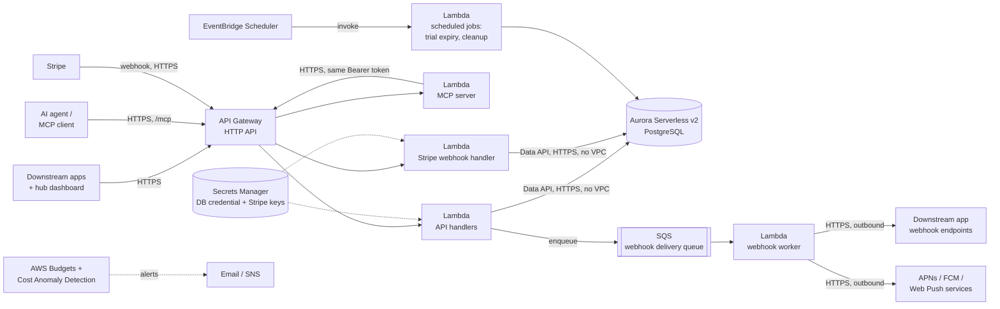

# Deployment Architecture

Where the platform API runs, as built, and how it's billed. This is a deployment and operations document, not part of the [API specification](https://compositecode.github.io/substratalapps.com/), so it lives next to the Terraform that implements it (`infra/terraform/`) rather than on the docs site: an API consumer never needs to know how this is hosted to build against it. Work that isn't built yet (scale-out, dedicated tenancy infrastructure, MCP streaming) is in [plan-remaining.md](../plan-remaining.md); one-time setup steps still to do by hand are in [remaining_manual_steps.md](../remaining_manual_steps.md).

Chosen and configured around one constraint above all others: **predictable, capped cost, with no surprises.**

1. [Cost principles](#cost-principles)
2. [First deployment (Tier 0)](#first-deployment-tier-0)
3. [AWS account & region](#aws-account--region)
4. [Cost guardrails](#cost-guardrails)
5. [Tenancy tiers & where they run](#tenancy-tiers--where-they-run)
6. [MCP server](#mcp-server)
7. [Stripe Billing](#stripe-billing)
8. [Transactional email](#transactional-email)
9. [Webhook dispatch](#webhook-dispatch)
10. [Push delivery](#push-delivery)
11. [Audit log archival](#audit-log-archival)
12. [Local development](#local-development)

---

## Cost principles

Four rules this architecture is built around, in priority order:

1. **No resource bills by the hour regardless of traffic.** No always-on EC2 instance, no Fargate task, no NAT Gateway. If nobody's calling the API, the API costs close to nothing.
2. **Every component with a cost has a known floor and a known ceiling.** "Serverless" isn't automatically cheaper — some AWS serverless products (Aurora Serverless v2's minimum capacity, for one) have a *higher* floor than the plain fixed-price alternative, and that trade is only worth it when something else about the product earns it back. See [Database engine: AWS options compared](#database-engine-aws-options-compared).
3. **A hard budget alarm exists before the first resource does.** Guardrails are step one of the build checklist below, not a follow-up task.
4. **Scale-out is a later, deliberate decision, not a default.** Nothing in Tier 0 auto-scales into real money without a human decision — see [Scale-out](../plan-remaining.md#scale-out) for what actually triggers each upgrade.

## First deployment (Tier 0)



| Component | Service | Why this one |
|---|---|---|
| API compute | **Lambda** behind **API Gateway (HTTP API)** | Pay-per-request, zero idle cost. HTTP API over REST API — materially cheaper per request for the same job. |
| MCP compute | A **second, dedicated Lambda** behind the same **API Gateway**, at `/mcp` | Kept as its own function (not folded into the API handlers' Lambda) specifically so its concurrency, cold-start profile, and any future upgrade (see [MCP server](#mcp-server)) can be tuned independently without touching the REST path — same reasoning as the webhook worker already being split out below. |
| Stripe webhook compute | A **third, dedicated Lambda**, at `/internal/stripe/webhook` | Isolated from the API handlers' Lambda for the same reason the MCP Lambda is — plus a real security reason: it's the one route whose caller isn't an API-key/Bearer-token holder at all, verified instead by Stripe's own signature scheme (see [Stripe Billing](#stripe-billing)), so keeping it a separate function keeps that distinct trust boundary legible in the IAM/routing layer, not just in code. |
| Database | **Aurora Serverless v2 (PostgreSQL)**, accessed via the **RDS Data API** | The domain model is relational (joins, foreign keys, the Audit log) — Postgres fits it directly. Data API means Lambda calls the database over signed HTTPS with **no VPC attachment** — which is what avoids a NAT Gateway entirely (see below), not a minor detail. |
| Webhook delivery | **SQS** queue + a dedicated worker **Lambda** | Matches the retry/backoff schedule in the [Webhooks](https://compositecode.github.io/substratalapps.com/api-reference/webhooks/) spec — SQS visibility timeouts drive the delay between attempts for free, no extra scheduler needed for that part. |
| Push delivery | The webhook **SQS** queue and **worker Lambda** | [Push notifications](https://compositecode.github.io/substratalapps.com/api-reference/notifications/) to APNs, FCM, and Web Push. The same outbox-and-nudge shape as webhooks, so no new queue or function. See [Push delivery](#push-delivery). |
| Scheduled jobs | **EventBridge Scheduler** → **Lambda** | Trial-expiry checks, idempotency-key cleanup — pay-per-invocation, no cron server to run. |
| Secrets | **Secrets Manager** — the Aurora master credential and the Stripe secret/webhook-signing keys | Everything else non-secret goes in Lambda environment variables rather than paying per-secret for config that isn't sensitive. |
| DNS / TLS | **Route 53** + **ACM** (free) + API Gateway custom domain | Backs the `api.substratalapps.com` base URL from the [API spec's Conventions](https://compositecode.github.io/substratalapps.com/api-reference/conventions/#base-url). |
| Static assets (avatars, etc.) | **S3** + **CloudFront** | Pay-per-use; negligible at Tier 0 volume. |
| Logs | **CloudWatch Logs**, retention capped at 30 days | Explicit retention is the fix for the single most common "why is my CloudWatch bill growing every month" surprise — logs left at *never expire* by default. |
| Cost guardrail | **AWS Budgets** (two thresholds) + **Cost Anomaly Detection** | See [Cost guardrails](#cost-guardrails) — this exists before the first Lambda does. |

### Database engine: AWS options compared

Postgres is the storage engine — the domain model is relational, and the schema depends on real foreign keys, `check` constraints, and Row-Level Security that a document store doesn't give for free. The question evaluated here is *which* AWS Postgres product, specifically for the lowest predictable starting price:

| Option | Starting price | Trade-off |
|---|---|---|
| **RDS for PostgreSQL**, single-AZ `db.t4g.micro` | ~$12–13/month, storage separate — the cheapest *fixed* number AWS offers | No Data API — Lambda needs a direct Postgres connection, which means VPC attachment, which reopens the NAT question this doc spent a whole section avoiding. Also no multi-cluster story: every tenancy tier would need its own bespoke connection-routing code, not just a lookup-table value. |
| **Aurora Provisioned (PostgreSQL-compatible)**, smallest instance | ~$55–60/month single-AZ — Aurora's smallest instance class is larger than RDS's smallest | Pricier than Serverless v2's floor for a low-traffic start, with none of Serverless v2's scale-with-load benefit. Not competitive against either other option at Tier 0 volume. |
| **Aurora Serverless v2 (PostgreSQL-compatible)**, 0.5 ACU minimum — **chosen** | ~$43/month floor, scales up with load | Costs more than bare RDS at idle. What it buys back: the **Data API**, which is why Tier 0 has no VPC at all (see [below](#why-no-vpc-and-specifically-no-nat-gateway)), and why [tenancy tiers](#tenancy-tiers--where-they-run) can route a request to any of several clusters — shared, or a specific customer's `isolated`/`dedicated_region` one — via one lookup-table value, with every tier using the identical connection mechanism. |

**The ~$30/month gap between RDS and Aurora Serverless v2 is a real, named cost** — not hand-waved away — paid specifically for not having to build and maintain two different database-connection code paths (one VPC-bound for a cheap shared tier, one Data-API-based for dedicated tenants) or a NAT Gateway. At Tier 0's actual scale (see [Growth trajectory](../plan-remaining.md#growth-trajectory)) that $30/month is a smaller cost than the engineering time either alternative would take to build and keep correct.

### Why no VPC, and specifically no NAT Gateway

A NAT Gateway (~$32/month plus per-GB data processing, easy to forget it's running) is the single most common unexpected line item in a small AWS bill, and it's usually there because *something* in a VPC needed outbound internet access. This architecture avoids needing one at all:

- The API Lambda talks to Aurora via the **Data API** (HTTPS, IAM-signed) instead of a direct Postgres connection — so it never needs to be placed inside the VPC in the first place.
- The webhook-delivery worker needs genuine outbound internet access (POSTing to arbitrary downstream URLs) — it gets that for free by **not** being placed in a VPC either; a Lambda outside a VPC has normal internet access by default, at no extra cost.

Net effect: zero VPC, zero NAT, for the entire Tier 0 stack. This is revisited in [Scale-out](../plan-remaining.md#scale-out) once throughput, not cost, becomes the binding constraint.

## AWS account & region

Resolved: a **dedicated AWS account**, in **`us-east-1`**.

**Dedicated account**, under an AWS Organization rather than reusing an existing personal/other-project account, specifically so [Cost guardrails](#cost-guardrails) below — the Budgets, the Cost Anomaly Detection baseline, the billing alarm — are scoped to exactly this system's spend from day one. A shared account makes every one of those guardrails a cost-allocation-tag exercise instead of an account-level default; at the current team size (one person plus an AI assistant, per the product's own stated growth plan) that's avoidable overhead, not a safety net worth the complexity. AWS Organizations (free) is still the right wrapper even for a single member account — it's what makes adding a second account (the [Scale-out](../plan-remaining.md#scale-out) trigger for a separate staging environment) a few-minutes operation later instead of a migration.

**`us-east-1`**, over other candidates, for three concrete reasons rather than "it's the default":

- **Service availability.** New AWS features — including, historically, Aurora Serverless v2 capability updates — land in `us-east-1` first and most reliably. For a Tier 0 build that wants to stay current with the cheapest/newest options as they ship, that matters more than it would for a mature, stable workload.
- **Pricing.** `us-east-1` is at or near the lowest-cost tier for every service in the [Tier 0 component table](#first-deployment-tier-0) above (Lambda, Aurora Serverless v2, API Gateway, S3) — a handful of regions tie it, none meaningfully undercut it for this stack.
- **No data-residency constraint pulling the other way.** Nothing in the [Compliance](https://compositecode.github.io/substratalapps.com/compliance/) posture or the current customer base requires EU or other non-US placement for the *shared* tier specifically — that requirement, when it exists, is what the `dedicated_region` [tenancy tier](#tenancy-tiers--where-they-run) is *for*, scoped to the one customer who needs it rather than forcing a region choice for everyone.

**As built (2026-10-20):** production is the member account `substratal-prod` in an AWS Organization created through the AWS console's Projects experience, with a separate management account (billing and policies) and an Identity delegated-admin account. Two consequences worth knowing:

- That Organization's region-restriction SCP (`AdvancedModeRegionRestrictionSecurityControlPolicy`) allows only global services in `us-east-1` by default. Its `UsEast1Partitional` statement carries an exception for `substratal-prod` (`StringNotEquals aws:PrincipalAccount`) so the stack can run there. The Projects feature might restore the original; if production calls suddenly fail with an explicit SCP deny, check that exception first.
- Console and CLI access go through the Projects role (`AccountFullAccessRole`), and the CLI signs in with `aws login`. The account's identity source (AWS Builder ID) doesn't offer IAM Identity Center permission sets.

This is a Tier 0 default, not a permanent commitment — nothing above prevents a `dedicated_region` Tenant from landing anywhere else, and nothing prevents revisiting the *shared* region later if a majority of the customer base ends up needing otherwise. Revisit if that happens; don't pre-build for it.

## Cost guardrails

Set up in this order, before any other resource:

1. **AWS Budgets** — two budgets on the account:
   - **Warn** budget: alerts at 50% / 80% / 100% of a modest monthly threshold (e.g. $75) — sized just above the known Tier 0 floor below, so it fires on real anomalies, not routine operation.
   - **Hard** budget: a [Budget Action](https://docs.aws.amazon.com/cost-management/latest/userguide/budgets-controls.html) at a second, higher threshold (e.g. $150) that automatically attaches a restrictive IAM policy to non-essential roles — a real circuit breaker, not just another email.
2. **AWS Cost Anomaly Detection** (free) — catches a spend spike from, say, a retry-loop bug days before a monthly Budget threshold would, specifically because it's pattern-based rather than threshold-based.
3. **CloudWatch billing alarm** as a third, independent tripwire — a single CloudWatch alarm on `EstimatedCharges` costs nothing and doesn't depend on either of the above working correctly.

### Illustrative Tier 0 floor cost

Rough, region-dependent, **not a quote**:

| Item | Approx. monthly floor |
|---|---|
| Aurora Serverless v2, 0.5 ACU minimum, running continuously | ~$43 |
| Aurora storage (low volume) | ~$1–5 |
| Secrets Manager (DB credential + Stripe keys, 2 secrets) | ~$0.80 |
| Route 53 hosted zone | ~$0.50 |
| Lambda + API Gateway + SQS + EventBridge at low traffic | Low single digits — much of this is covered by the AWS free tier for the first 12 months |
| S3 + CloudFront at low volume | Near $0 |
| MCP Lambda, Stripe webhook Lambda, low call volume each | Low single digits combined, same free-tier coverage as the API handlers' Lambda |
| **Floor total** | **~$45–55/month**, before any real traffic |

## Tenancy tiers & where they run

Only `shared` is built. Every Tenant lives in the Tier 0 cluster today; the `isolated` and `dedicated_region` rows below are the design, and their provisioning, request routing, and migration runbook are in [plan-remaining.md → Dedicated tenancy infrastructure](../plan-remaining.md#dedicated-tenancy-infrastructure).

[Tenancy](https://compositecode.github.io/substratalapps.com/domain-model/tenancy/) is a second, independent scale-out axis — triggered by one customer's requirement, not by aggregate volume, and can happen on day one for a single large customer well before the traffic-driven triggers above are anywhere close.

| Tier | Infrastructure | Relationship to Tier 0 above |
|---|---|---|
| `shared` | **Built.** Exactly [Tier 0](#first-deployment-tier-0) as specified — the same Aurora cluster every other `shared`-tier Tenant uses, isolated by `tenant_id` in the data-access layer (see [NFR → Multi-tenancy](https://compositecode.github.io/substratalapps.com/non-functional-requirements/#multi-tenancy)). | Is Tier 0. No separate infrastructure exists for this tier. |
| `isolated` | A second (third, fourth, …) Aurora Serverless v2 cluster, its own Secrets Manager secret, same AWS account and region as Tier 0. The API Lambda's Data API calls are routed to the right cluster via a small `tenants` lookup table kept in the primary/shared cluster — no new Lambda functions, no code fork. | One extra Aurora floor (~$45–55/month) per `isolated` Tenant — priced per [Pricing](https://compositecode.github.io/substratalapps.com/pricing/#business-and-enterprise). |
| `dedicated_region` | Like `isolated`, but the dedicated cluster — and, if latency to that region matters, a regional API Gateway + Lambda deployment in front of it — sits in the customer's chosen AWS region. | The `isolated` floor again, in a second region. |

## MCP server

See the [API spec's MCP Server page](https://compositecode.github.io/substratalapps.com/mcp-server/) for what this component is and why it exists; this section is the build-out and cost side of it specifically.

### Tier 0

A dedicated Lambda (shown in the [Tier 0 diagram](#first-deployment-tier-0) above as `MCP`), behind the same API Gateway, at a new `/mcp` route alongside the existing `/v1/*` routes — no new domain, no new certificate, no new hosted zone. On each MCP tool call, this Lambda:

1. Validates the `Mcp-Session-Id` (a signed, self-contained token) and decodes the JSON-RPC request.
2. Maps the requested tool name back to its `operationId` and calls the matching `/v1/...` route on the **same** API Gateway, forwarding the caller's own `Authorization` header unchanged.
3. Translates the REST response into the MCP result shape and returns a single, buffered JSON response.

This Lambda never talks to Aurora, Secrets Manager, or SQS directly — it only ever calls the existing API handlers over HTTPS, so its IAM execution role needs no data-plane permissions at all. It's the cheapest possible shape for this component: pure compute, pay-per-call, the same free-tier coverage as the main API handlers' Lambda.

## Stripe Billing

[Pricing](https://compositecode.github.io/substratalapps.com/pricing/) specifies the tiers and the [Stripe catalog](https://compositecode.github.io/substratalapps.com/pricing/#stripe-catalog). [API Reference → Billing](https://compositecode.github.io/substratalapps.com/api-reference/billing/) specifies the endpoints. This section is how the integration is built and run. The subscriber is a User (an individual subscription) or an Organization (for the members it covers), never a Tenant.

### Objects and mapping

| Stripe object | Maps to |
|---|---|
| Customer | One per subscribing User or Organization, created at their first Checkout (`metadata.subscriber_type`, `metadata.subscriber_id`) and stored in `users.stripe_customer_id` / `organizations.stripe_customer_id`. Free Users have none. |
| Subscription | One per [`subscriptions`](https://compositecode.github.io/substratalapps.com/domain-model/database-schema/#subscriptions) row, with one item on `standard_monthly_usd`: quantity 1 for an individual, the covered-member count for an Organization. `metadata` carries `subscription_id` (our `sbs_…`) and the subscriber. |
| Product / Price | One Product (`substratal_standard`, `metadata.substratal_plan: standard`) and one Price (`standard_monthly_usd`, $6.00, per unit, licensed, monthly), created once per Stripe mode by the idempotent `cmd/stripe-catalog` (`make stripe-catalog`). Code resolves the price by `lookup_key`, or by `STRIPE_PRICE_STANDARD` if set, never by a hard-coded id. |
| Checkout Session | `mode: subscription`, `customer` = the subscriber's Customer, `client_reference_id` = the `sbs_…` id, `subscription_data.metadata` as above, `automatic_tax: {enabled: true}`, `billing_address_collection: required`. |
| Customer Portal | One configuration: update payment method, view invoices, cancel at period end. Plan switching is **disabled**: there's one plan, and an Organization's covered members change through the API. |
| Invoice | Not mirrored. Stripe is the system of record for invoices and receipts. |

Secrets: `stripe_secret_key` (a restricted key: Customers, Subscriptions, Checkout, Portal, Prices read) and `stripe_webhook_secret` in the `substratal-prod/app` secret. Test mode and live mode are separate keys. Production uses the live key, so it refuses test-mode Checkout (`409 test_mode_billing_unavailable`); every non-production environment uses the test key.

### Schema

Specified in full in [Database Schema → subscriptions](https://compositecode.github.io/substratalapps.com/domain-model/database-schema/#subscriptions): one row per subscriber, created `incomplete` by the first Checkout and updated in place across lapses and resubscribes, plus `stripe_customer_id` on `users` and `organizations`, `applications.access_tier`, and `entitlements.subscription_id`. Migration `0002_subscriptions.sql` added all of it and dropped the Tenant billing columns of the earlier, developer-billed design in the same file, because no release had run against them.

### Webhook handling

```
POST /internal/stripe/webhook
```

Not under `/v1`, the same reasoning as the MCP server's `/mcp` route: it isn't a REST resource a caller invokes, it's an inbound event sink with its own Stripe-defined contract and versioning. It's not Bearer-authenticated either. It verifies the `Stripe-Signature` header against the raw body with the webhook secret (a 5-minute tolerance), the same shape as this API's own outbound [webhook signatures](https://compositecode.github.io/substratalapps.com/api-reference/webhooks/#verifying-the-signature).

**Processing model:** insert the Stripe event id into `stripe_events` (on conflict do nothing, so a duplicate returns `200` immediately), process it in the same invocation, and return `200`. A failure leaves `processed_at` null, and the `stripe-events` job (every 10 minutes) re-fetches and reprocesses it. Processing is one Stripe read and one transaction, well inside Stripe's timeout, and the retry job gives the same durability a queue would. Each handler **re-fetches the Subscription from Stripe** rather than trusting the event payload, which makes out-of-order delivery harmless: whatever arrives last, the row ends up matching Stripe's current state.

| Stripe event | Effect |
|---|---|
| `checkout.session.completed` | Find the row from `client_reference_id`, link `stripe_subscription_id`, then run the sync below. |
| `customer.subscription.created` / `.updated` / `.deleted` | **Subscription sync:** set `status`, `current_period_start`/`_end`, and `cancel_at_period_end`, writing `subscription.status_changed` on a change. In the same transaction, reconcile the subscriber's platform-managed Entitlements: grant `source: subscription` rows while the status is `active`/`trialing`/`past_due`, end them otherwise. `access.granted` / `access.revoked` fire for every User whose access changed. |
| `invoice.payment_failed` | Sync, which sets `past_due`. Coverage continues while Stripe Smart Retries (about 3 weeks) runs; only a later `unpaid` or `canceled` ends it. |
| `invoice.paid` | Sync, which clears `past_due`. |

After a resubscribe the row tracks the new Stripe subscription, so a non-covering state reported for the old one (a late or re-fetched event) is ignored rather than ending the new coverage. The sync runs in the subscription's own mode (looked up across both first), so a test-mode subscription's audit events and Entitlements are test-mode too. `stripe_events.subscription_id` records which row an event was applied to.

### Quantity sync

A daily EventBridge Scheduler rule (00:15 UTC, the `seat-sync` job) computes each covering Organization subscription's covered members (active Users with an active membership, included by `member_scope`, in the subscription's own mode) and, if the count changed since `quantity_synced`, writes it to the subscription item with `proration_behavior: "none"`, at least 1. Stripe idempotency keys are `quantity-sync:<subscription_id>:<date>:<quantity>`. Individual subscriptions are always 1 and never synced.

### Access reconcile

The `subscription-access` job (hourly) reconciles every platform-managed Entitlement in both modes against the Applications' `access_tier` and the subscriptions that cover their holders. Every change that matters already reconciles inline (signup, Checkout sync, member-scope changes, Application create and tier change), so this only repairs drift; on a healthy system it changes nothing.

### Keeping this honest

**Stripe's official MCP server** is the recommended tool for building and testing this integration. It has about 25 tools covering customers, products, prices, subscriptions, invoices, and payment flows, so the webhook-handling logic above can be developed and verified against real Stripe test-mode objects from inside an agentic coding session. Two ways to run it:

- **Hosted**, at `https://mcp.stripe.com` — OAuth per the MCP spec, or an API key as a Bearer token for clients that don't speak OAuth.
- **Local**, via `npx -y @stripe/mcp --api-key=<test-mode secret key>`.

Point it at Stripe **test mode** only, with a `sk_test_…` key. Use `stripe listen --forward-to localhost:<port>/internal/stripe/webhook` to drive the handler locally, and `stripe trigger customer.subscription.deleted` and friends to exercise every row of the table above.

## Transactional email

Native auth sends email: verification, password reset, invitations, MFA and password-change notices, and tier-change windows. That email goes through **Amazon SES** in the same account and region, so there's no new sub-processor.

- The sending domain is `mail.substratalapps.com`, with DKIM, SPF, and a DMARC `p=quarantine` policy set up in Route 53 before the first send. Request SES production access (out of the sandbox) as part of the build checklist, because it takes about a day.
- Templates are SES templates versioned in the repo. The From name is the Application's `email_from_name` when the email was triggered from inside an app, and "Substratal" otherwise.
- Sends go through SQS so an SES throttle never fails an API request. A bounce or complaint (from the SES → SNS notification) marks the address undeliverable, and auth emails to it are skipped and logged.
- Cost at Tier 0 volume is effectively $0 ($0.10 per 1,000 emails).

## Webhook dispatch

Outbound webhooks use a **transactional outbox**. Every state-changing transaction inserts its `webhook_events` rows in the same commit (see [Database Schema](https://compositecode.github.io/substratalapps.com/domain-model/database-schema/#webhook_subscriptions-webhook_events-webhook_deliveries)). A dispatcher Lambda, triggered every few seconds by an EventBridge Scheduler rule and also invoked directly after commit as a fast path, fans each event out to matching subscriptions as SQS messages. Delivery workers POST with a 5-second timeout, and failed attempts are re-enqueued with SQS delay (up to 15 minutes) or EventBridge Scheduler one-shot schedules for the 2-hour and 12-hour retries. No always-on component, consistent with the [cost principles](#cost-principles).

The delivery worker reserves 5 concurrent executions, so a burst of deliveries can't starve the API. A new AWS account's Lambda concurrency limit is only 10, and AWS requires 10 to stay unreserved, so Terraform reads the account's applied limit (Service Quotas, `L-B99A9384`) on every deploy and reserves the 5 only when the limit is at least 100. Until then, the worker shares the account's concurrency with everything else.

## Push delivery

[Push Notifications](https://compositecode.github.io/substratalapps.com/api-reference/notifications/) specifies the behavior. This is how it runs, on top of the webhook machinery above, with no new always-on component.

- **Outbox.** A send inserts the `notifications` row and one `notification_deliveries` row per eligible device in the same transaction ([Database Schema](https://compositecode.github.io/substratalapps.com/domain-model/database-schema/#push_credentials-devices-notifications-notification_deliveries)). After commit, the API nudges the webhook SQS queue. A nudge carries no payload, so one queue serves both outboxes. The existing 1-minute `webhook-dispatch` sweep runs push delivery too, so a lost nudge only delays a push.
- **Worker.** The existing webhook worker Lambda drains push deliveries first on every invocation, then webhooks, because a push outcome can emit webhook events (`device.deactivated`, `notification.push_failed`). Each delivery is claimed with a 2-minute lease, so no database transaction stays open across a provider call. The worker decrypts the Application's credential and the device token with the same symmetric KMS key used for webhook and TOTP secrets, and keeps a per-credential cache of provider auth across warm invocations: the APNs provider JWT (ES256, refreshed every 50 minutes, inside Apple's 20–60 minute window), the FCM OAuth 2.0 access token (refreshed before its one-hour expiry), and the VAPID JWT (ES256, at most 12 hours). APNs needs HTTP/2, which Go's standard client supports, and one connection per gateway (production, sandbox) is reused across deliveries in an invocation.
- **No VPC, no NAT.** The worker already runs outside a VPC for outbound webhooks, so it reaches `api.push.apple.com`, `fcm.googleapis.com`, and browser push endpoints at no extra cost.
- **Retries** are scheduled in the database (`next_attempt_at`: +30 seconds, +2 minutes, +10 minutes, within the notification's `ttl_seconds`) and picked up by the 1-minute sweep, so a retry runs up to a minute after it comes due. Provider responses that mean the token is gone deactivate the device, and ones that mean the credential is bad mark the credential `failed` and email the Application's owner, both in the worker's own transaction.
- **Secrets.** Push credentials are per Application and live KMS-encrypted in Aurora, not in Secrets Manager, which would cost $0.40 a month per Application for no added safety. Device tokens are encrypted the same way.
- **Scheduled jobs** (the existing jobs Lambda): `push-maintenance`, daily at 04:30 UTC, runs the 270-day stale-device sweep, deletes inactive devices 30 days after deactivation, and purges notifications after 90 days and delivery results after 30.
- **Cost.** APNs, FCM, and Web Push charge nothing to send. At Tier 0 volume the worker time is a rounding error, and so is KMS: two decrypts per delivery (credential and token), at $0.03 per 10,000.
- **`PUSH_BACKEND`** selects the sender: `live` (production's default) sends to the providers, and `log` (the local default) only logs each push. Locally, the devserver delivers in-process, the same as webhooks, so the whole flow works without real Apple or Google credentials. Tests use a recording fake.

## Audit log archival

[Non-Functional Requirements → Audit log lifecycle](https://compositecode.github.io/substratalapps.com/non-functional-requirements/#audit-log-lifecycle) specifies the hot/cold split that keeps "retained indefinitely" true without every [Pricing](https://compositecode.github.io/substratalapps.com/pricing/) tier paying for the same amount of fast storage. The mechanical side of that, on top of the [Tier 0](#first-deployment-tier-0) stack above:

| Step | Mechanism |
|---|---|
| Trigger | A daily **EventBridge Scheduler** rule, the same pattern already used for trial-expiry/idempotency-key cleanup — invokes a dedicated Lambda. |
| Select | Query `audit_events` for rows older than the hot window (one year for every Tenant — see [NFR → Audit log lifecycle](https://compositecode.github.io/substratalapps.com/non-functional-requirements/#audit-log-lifecycle)), oldest first using the existing `(timestamp desc, id desc)` index (see [Database Schema → audit_events](https://compositecode.github.io/substratalapps.com/domain-model/database-schema/#audit_events)). |
| Archive | Write the shape-only fields (`id`, `action`, `actor_type`, `actor_id`, `target_type`, `target_id`, `target_user_id`, `application_id`, `organization_id`, `tenant_id`, `request_id`, `timestamp`) — **never** `before`/`after` — as newline-delimited JSON to **S3**, under a lifecycle rule that transitions objects straight to **S3 Glacier Deep Archive** on arrival. This is the one-way redaction step: the snapshot values are dropped here, not carried into cold storage and redacted later. |
| Prune | Delete the archived rows from the hot `audit_events` table once the S3 write is confirmed — keeps Aurora storage cost bounded by the hot window, not by all-time event volume. |
| Retrieve | A Glacier Deep Archive restore job (support-initiated, ~12-hour retrieval SLA) for the rare dispute/investigation that needs an archived event's shape — there is no live API path to cold storage, deliberately; see [Non-Functional Requirements → Audit log lifecycle](https://compositecode.github.io/substratalapps.com/non-functional-requirements/#audit-log-lifecycle). |

Cost is negligible at Tier 0 volume (Glacier Deep Archive is priced for exactly this shape of rarely-read, kept-forever data) — this is about bounding Aurora's hot-table size and honoring the redaction-on-age guarantee, not about saving money on S3 itself.

### Audit exports

[`POST /v1/audit-exports`](https://compositecode.github.io/substratalapps.com/api-reference/audit/#exporting) files go to a second private bucket, `substratal-prod-audit-exports-<account>` (SSE-S3, public access blocked), with a lifecycle rule that deletes every object after 7 days, matching the export record's `expires_at`. The `audit-exports` job runs every minute on the jobs Lambda, pages through the matching events into a temporary file, and uploads it (`AUDIT_EXPORT_BUCKET`, `s3:PutObject`). The API Lambda signs the 15-minute download links, so it holds `s3:GetObject` on that bucket only. Locally, exports are written under `.dev/audit-exports` and the devserver runs the worker every 15 seconds.

## Local development

The RDS Data API choice that keeps Tier 0 NAT-free has a real cost: it doesn't have a clean open-source local emulator, so a developer can't just point the production data-access code at "Data API, but local" the way they could with a plain Postgres driver.

The fix is to not let that choice leak into the application code in the first place: put all database access behind a small repository/data-access interface, with two implementations — one using the Data API (what Lambda runs in every real environment), one using a direct Postgres driver against a local `docker-compose` Postgres (what runs on a laptop and in CI). Business logic and request handlers talk to the interface and never know which implementation is underneath.

Stripe's own test mode (plus the Stripe MCP server referenced in [Stripe Billing](#stripe-billing)) covers the equivalent problem on the billing side — no local Stripe emulator is needed, since Stripe's hosted test mode is free and already the standard way to develop against it.

The full local setup (Docker Compose services, the devserver, `make` targets) and the `dev` → `main` → production deployment flow are in [README.md → Local development](../README.md#local-development) and [README.md → Branches, CI, and deployment](../README.md#branches-ci-and-deployment).
