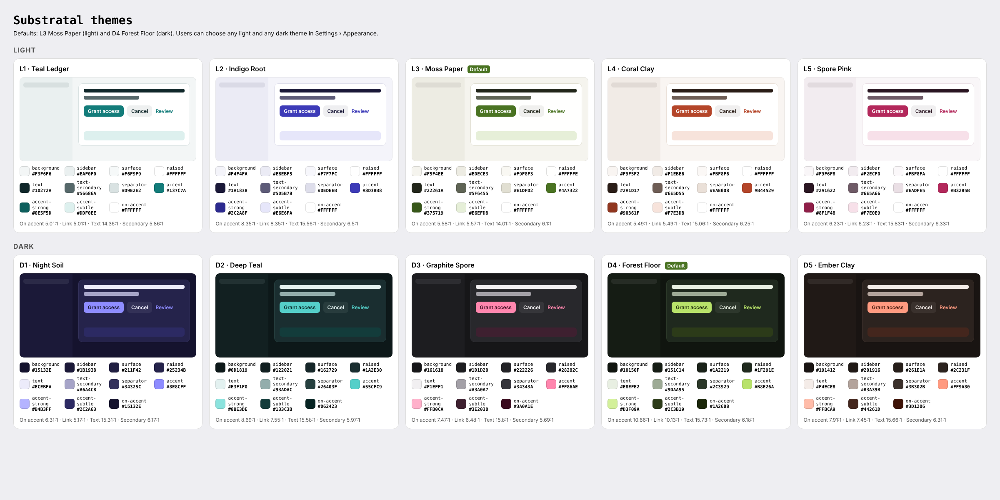

# Substratal themes

The Hub ships **five light and five dark themes** on every platform. The defaults are **L3 Moss Paper** (light) and **D4 Forest Floor** (dark). Every reference screen and mockup is rendered in both defaults. Users can switch to any of the other themes in **Settings › Appearance** (SET-01).

## 1. What the user controls

| Setting | Values | Stored in | Default |
|---|---|---|---|
| Appearance | Light · Dark · Match system | `Settings.theme` (`light` / `dark` / `system`) via `PATCH /users/me/settings` | Match system |
| Light theme | `teal-ledger`, `indigo-root`, `moss-paper`, `coral-clay`, `spore-pink` | `app_hub` per-app setting `appearance.light_theme` via `PATCH /users/me/apps/app_hub/settings` | `moss-paper` |
| Dark theme | `night-soil`, `deep-teal`, `graphite-spore`, `forest-floor`, `ember-clay` | `app_hub` per-app setting `appearance.dark_theme` | `forest-floor` |

**Resolution:**

- Dark is used when Appearance is *Dark*, or when it is *Match system* and the OS is currently dark. Otherwise light is used.
- Dark uses the chosen dark theme and light uses the chosen light theme.
- Theme choices are independent: a user can pair any light theme with any dark theme.

**Persistence:**

1. A change applies **instantly** and is written to the local cache first.
2. It is then synced with `If-Match`. On 409, re-fetch and re-apply; on 422, revert and show a toast.
3. On launch, the cached values are applied before first paint, then reconciled with the server.
4. A missing or unknown id falls back to the default for that mode. Keys are lowercase kebab-case.

The `app_hub` `settings_schema` must declare the two keys; see OPEN-QUESTIONS #22. Until it does, store them on the device only.

Other apps on the platform are unaffected. They read `Settings.theme` only, as before.

## 2. Token roles

Every platform implements the same roles. Names come from `themes/themes.json`.

| Role | Used for |
|---|---|
| `background` | Window or grouped background (iOS grouped, Android surface, Windows Mica tint) |
| `sidebar` | Sidebar and navigation rail (macOS, Windows, GNOME, web) |
| `surface` | Subtle cards, group backgrounds, app tiles |
| `raised` | Content panes, list cells, text fields, dialogs, menus |
| `text` / `text-secondary` / `text-tertiary` | Primary text and icons / captions / placeholders and disabled only |
| `separator` | Hairlines, borders, table rules |
| `accent` | Primary buttons, switches, checkboxes, focus ring, selected chips, the macOS selected row, tint |
| `accent-strong` | Hover and pressed accent; the tint under Increase Contrast; link text where accent is below 4.5:1 on light |
| `on-accent` | Text and icons on accent fills (dark ink on the bright dark-theme accents) |
| `accent-subtle` | Selected rows (non-macOS), info banners, the selected inbox item |
| `link` | Link text |
| `control-fill` / `control-fill-strong` | Secondary buttons, search fields, segmented tracks / progress tracks |
| `scrim` + `scrim-opacity` | Modal scrims |

**Not themed** (the same in every theme):

- Status badge colours (`status-semantics.json`, light and dark sets)
- Danger red
- The logo and app icon (`brand/`)
- Third-party app icons
- Avatar hues

## 3. Palettes

### Light

| | Theme | id | Background | Sidebar | Surface | Raised | Text | Secondary | Separator | Accent | Accent strong | Accent subtle | On accent |
|---|---|---|---|---|---|---|---|---|---|---|---|---|---|
| L1 | Teal Ledger | `teal-ledger` | `#F3F6F6` | `#EAF0F0` | `#F6F9F9` | `#FFFFFF` | `#10272A` | `#56686A` | `#D9E2E2` | `#137C7A` | `#0E5F5D` | `#DDF0EE` | `#FFFFFF` |
| L2 | Indigo Root | `indigo-root` | `#F4F4FA` | `#EBEBF5` | `#F7F7FC` | `#FFFFFF` | `#1A1838` | `#5D5B78` | `#DEDEEB` | `#3D3BB8` | `#2C2A8F` | `#E6E6FA` | `#FFFFFF` |
| L3 | **Moss Paper** (default) | `moss-paper` | `#F5F4EE` | `#EDECE3` | `#F9F8F3` | `#FFFFFE` | `#22261A` | `#5F6455` | `#E1DFD2` | `#4A7322` | `#375719` | `#E6EFD8` | `#FFFFFF` |
| L4 | Coral Clay | `coral-clay` | `#F9F5F2` | `#F1EBE6` | `#FBF8F6` | `#FFFFFF` | `#2A1D17` | `#6E5D55` | `#EAE0D8` | `#B44529` | `#90361F` | `#F7E3DB` | `#FFFFFF` |
| L5 | Spore Pink | `spore-pink` | `#F9F6F8` | `#F2ECF0` | `#FBF8FA` | `#FFFFFF` | `#2A1622` | `#6E5A66` | `#EADFE5` | `#B3285B` | `#8F1F48` | `#F7E0E9` | `#FFFFFF` |

### Dark

| | Theme | id | Background | Sidebar | Surface | Raised | Text | Secondary | Separator | Accent | Accent strong | Accent subtle | On accent |
|---|---|---|---|---|---|---|---|---|---|---|---|---|---|
| D1 | Night Soil | `night-soil` | `#15132E` | `#1B1938` | `#211F42` | `#25234B` | `#ECEBFA` | `#A6A4C8` | `#34325C` | `#8E8CFF` | `#B4B3FF` | `#2C2A63` | `#15132E` |
| D2 | Deep Teal | `deep-teal` | `#0D1819` | `#122021` | `#162729` | `#1A2E30` | `#E3F1F0` | `#93ADAC` | `#26403F` | `#55CFC9` | `#8BE3DE` | `#133C3B` | `#062423` |
| D3 | Graphite Spore | `graphite-spore` | `#161618` | `#1D1D20` | `#222226` | `#28282C` | `#F1EFF1` | `#A3A0A7` | `#34343A` | `#FF86AE` | `#FFB0CA` | `#3E2030` | `#3A0A1E` |
| D4 | **Forest Floor** (default) | `forest-floor` | `#10150F` | `#151C14` | `#1A2219` | `#1F291E` | `#E8EFE2` | `#9DAA95` | `#2C3929` | `#B8E26A` | `#D3F09A` | `#2C3B19` | `#1A2608` |
| D5 | Ember Clay | `ember-clay` | `#191412` | `#201916` | `#261E1A` | `#2C231F` | `#F4ECE8` | `#B3A39B` | `#3B302B` | `#FF9A80` | `#FFBCA9` | `#44261D` | `#3D1206` |

The full set, including derived roles, is in `themes/themes.json` and `themes/themes.csv`.

## 4. Contrast (WCAG 2.2 AA, checked for every theme)

| Theme | On accent / accent | Link / raised | Text / background | Secondary / raised | Secondary / background |
|---|---|---|---|---|---|
| L1 Teal Ledger | 5.01:1 | 5.01:1 | 14.36:1 | 5.86:1 | 5.39:1 |
| L2 Indigo Root | 8.35:1 | 8.35:1 | 15.56:1 | 6.5:1 | 5.93:1 |
| L3 Moss Paper | 5.58:1 | 5.57:1 | 14.01:1 | 6.1:1 | 5.54:1 |
| L4 Coral Clay | 5.49:1 | 5.49:1 | 15.06:1 | 6.25:1 | 5.77:1 |
| L5 Spore Pink | 6.23:1 | 6.23:1 | 15.83:1 | 6.33:1 | 5.9:1 |
| D1 Night Soil | 6.31:1 | 5.17:1 | 15.31:1 | 6.17:1 | 7.53:1 |
| D2 Deep Teal | 8.69:1 | 7.55:1 | 15.58:1 | 5.97:1 | 7.59:1 |
| D3 Graphite Spore | 7.47:1 | 6.48:1 | 15.8:1 | 5.69:1 | 7.01:1 |
| D4 Forest Floor | 10.66:1 | 10.13:1 | 15.73:1 | 6.18:1 | 7.58:1 |
| D5 Ember Clay | 7.91:1 | 7.45:1 | 15.66:1 | 6.31:1 | 7.5:1 |

**Contrast modes:**

- **Windows High Contrast, `forced-colors` on the web, GNOME High Contrast:** the Substratal theme is turned off and system colours apply.
- **macOS/iOS Increase Contrast and Android high-contrast text:** tint with `accent-strong`, and use `text-secondary` wherever `text-tertiary` would carry information.

## 5. Platform implementation

| Platform | Files | Mechanism |
|---|---|---|
| iOS / macOS | `theme/SubstratalTheme.swift`, `theme/Assets.xcassets/AccentColor` | `ThemeStore` (`@Observable`) supplies `\.palette` and `.tint` from the root modifier `.substratalTheme(store)`; `.preferredColorScheme` from Settings.theme. The AccentColor asset holds the defaults for launch and UIKit/AppKit bridges. |
| Windows | `theme/SubstratalThemes.xaml`, `theme/Themes/{Light,Dark}/*.xaml`, `theme/ThemeService.cs` | Theme dictionaries override `SystemAccentColor*`, text, fill and stroke resources and add `Substratal*Brush`. `ThemeService` swaps the Light/Dark dictionaries and sets `RequestedTheme`. Mica is tinted with `background`. |
| Android | `theme/SubstratalThemes.kt`, `theme/res/values{,-night}/substratal_theme.xml` | Ten Material 3 `ColorScheme`s. `SubstratalTheme(mode, light, dark)` picks one. Dynamic colour is off. The XML defaults cover the splash screen and system bars. |
| Linux | `theme/{light,dark}/*.css`, `theme/README.md` | Redefines libadwaita named colours. A single `Gtk.CssProvider` reloads on `AdwStyleManager notify::dark`; none is loaded in high contrast. |
| Web | `theme/themes.css`, `theme/themes.ts`, `theme/head-snippet.html` | `--sub-*` custom properties keyed by `data-scheme`, `data-light-theme` and `data-dark-theme` on `<html>`. The inline head script prevents a flash of the wrong theme, and `theme-color` follows the theme. |

## 6. Previewing in the mockups

Every `mockups/*.html` accepts:

- `?mode=dark`
- `?light=<id>` (any light theme)
- `?dark=<id>` (any dark theme)

For example, `APP-01-home.html?mode=dark&dark=night-soil`. The reference PNGs are in `screens/light/` and `screens/dark/`.
