# UX Flows

Screen IDs in brackets refer to `SCREEN-SPECS.md`. Flow → screens: F1 AUTH-03/04 · F2 AUTH-01/02/05/06 · F3 APP-01/02/03 · F4 ACC-04/05/06 · F5 ACC-07/08 · F6 USR-01/03, ACX-01..04 · F7 ROL-01..04 · F8 ORG-01..09 · F9 APL-02/03, KEY-02/03, WHK-02/03 · F10 BIL-01/03 · F11 AUD-01/02 · F12 NTF-04/03 · F13 NTF-01/02, ORG-09 · F14 BIL-02/03, ORG-03 · F15 APL-07, NTF-03 · F16 NTF-05/06.

Each flow lists the screens, the API calls behind each step, and the branches the UI must handle. Diagrams are Mermaid (render in GitHub, VS Code, or open `ux-flows.html` in this folder).

---

## F1 · First run: sign up → verify → home

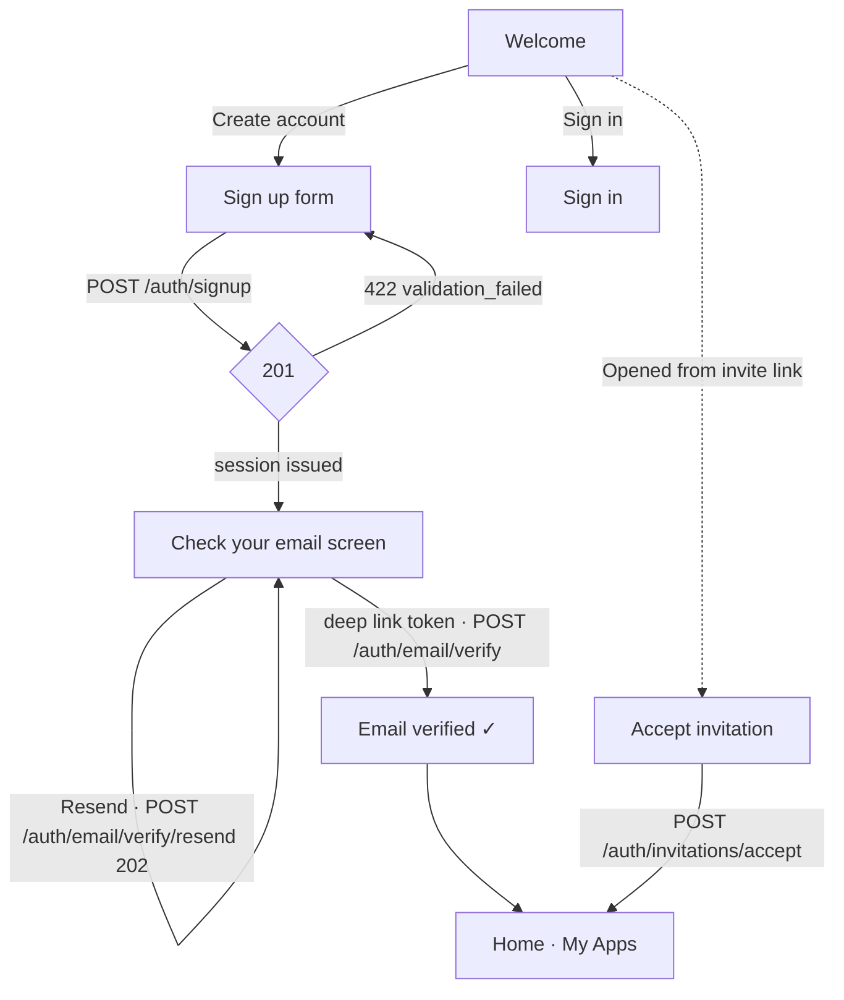

- Signup returns a session immediately; unverified users reach Home with a persistent "Verify your email" banner.
- Every new account is on **Free** with access to every free app (platform-managed `free` entitlements); standard apps show as "Included with Standard".
- Password field: show strength meter, show/hide toggle, platform password-manager autofill (`textContentType=.newPassword`, `autocomplete="new-password"`).

## F2 · Sign in with MFA and session upkeep

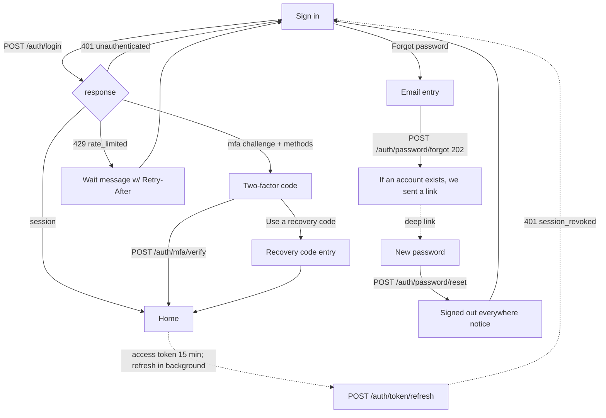

- MFA challenge expires (`expires_in` ≈ 300 s): show a quiet countdown; on expiry return to Sign in with message.
- Store refresh token in the platform secure store only (Keychain, Credential Locker/DPAPI, Android Keystore-backed EncryptedSharedPreferences/DataStore, libsecret).
- Offer biometric unlock to re-open the app (Touch ID/Face ID, Windows Hello, BiometricPrompt, — on Linux, OS keyring unlock) — this gates access to the stored refresh token; it is not a server auth factor.

## F3 · Launch an app (the MVP happy path)

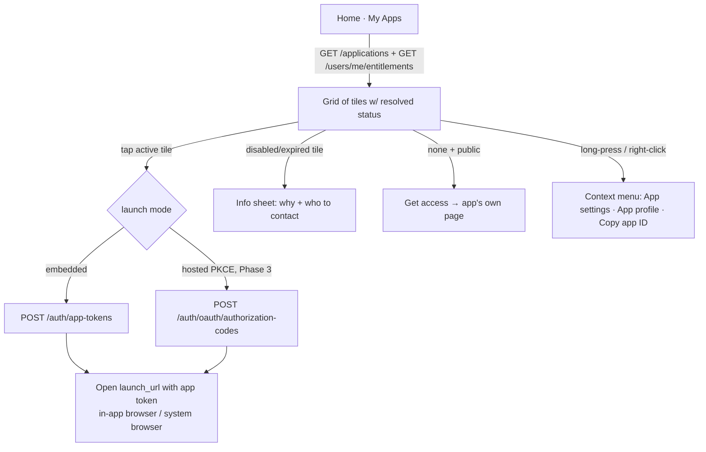

- Tile ordering: Recently launched, then alphabetical. Pin/favorite is client-side only.
- App token TTL is 5 minutes — mint at tap time, never cache.

## F4 · Account security: enable two-factor

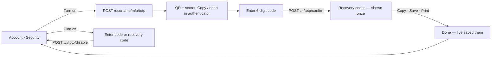

- Recovery-code screen blocks dismissal until "I've saved these" is checked.
- Sessions list: current device marked "This device"; "Sign out of all other sessions" revokes each other session (`DELETE /users/me/sessions/{id}`), which also deactivates their push devices.
- Turning 2FA off raises a `security.mfa_disabled` platform alert to every Hub device (F13).

## F5 · Delete my account / export my data

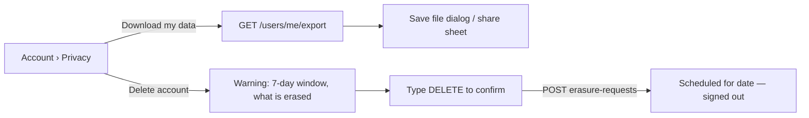

## F6 · Admin turns a user's access off (and back on)

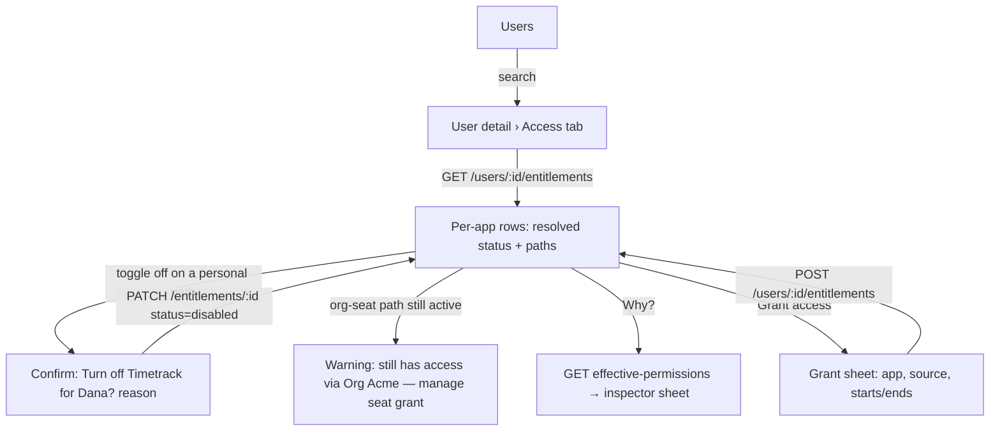

- Optimistic toggle with rollback on error; success toast "Access turned off · Undo" (Undo = PATCH back to `active`, within toast lifetime).
- If the user only has access through an organization, the switch on that row is replaced by "Via Acme (seat)" with a link to the org's seat grant.
- `DELETE` (hard remove) appears only when eligible (developer grant, no `order_id`, < 24h) as "Remove grant made in error".
- Platform-managed rows (`free`, `subscription`) only toggle off/on; the confirm explains the access comes with their plan and stays off until turned back on.

## F7 · Roles

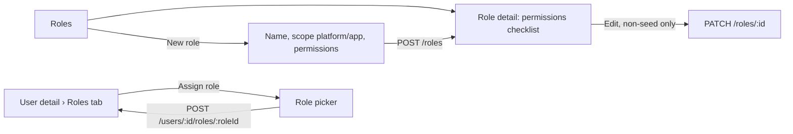

## F8 · Organization admin

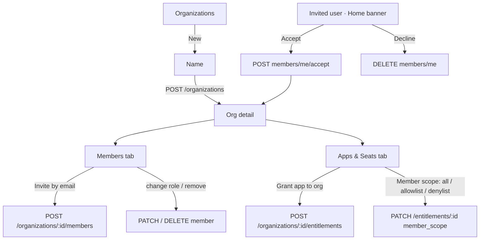

## F9 · Developer: register an app, get credentials, wire webhooks

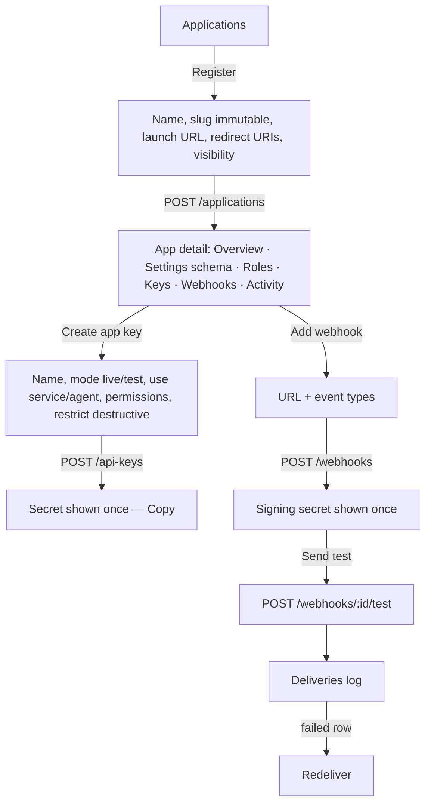

- Key rotation copy: "The current secret stops working immediately." Webhook secret rotation copy: "Both secrets are valid for 24 hours."

## F10 · A person upgrades to Standard

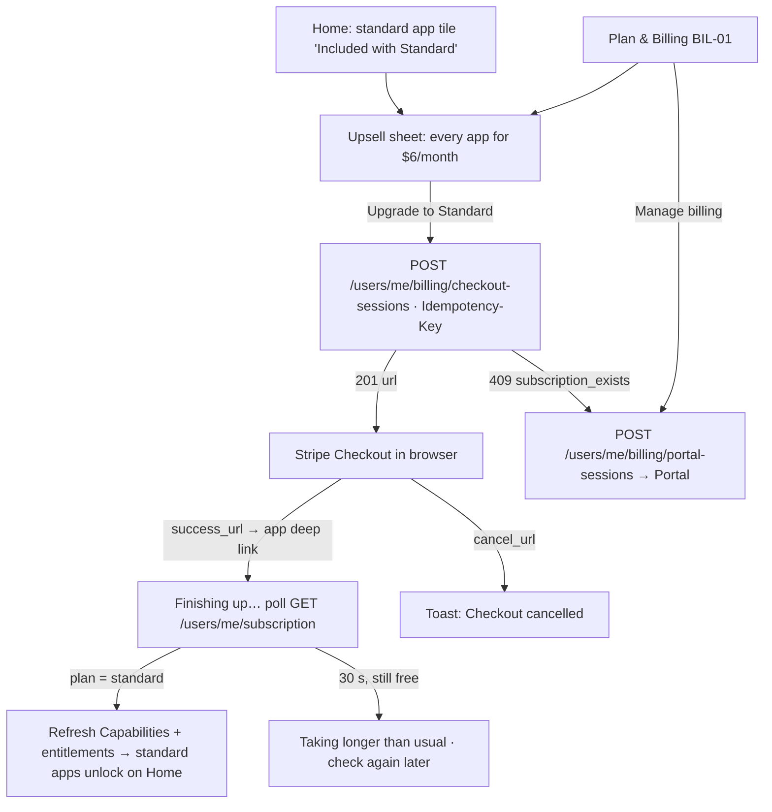

- Mobile store builds show the Upgrade button only when its store flag is on (OPEN-QUESTIONS #10).
- Covered by an org and also subscribed individually → BIL-01 suggests cancelling the individual subscription in the Portal.
- `past_due` keeps access (Stripe retries ~3 weeks); BIL-01 shows "Payment issue · Update it in Manage billing".

## F11 · Audit investigation

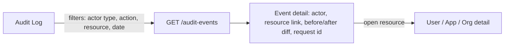

---

## F12 · Turn on push notifications (iOS, macOS, Android, Web)

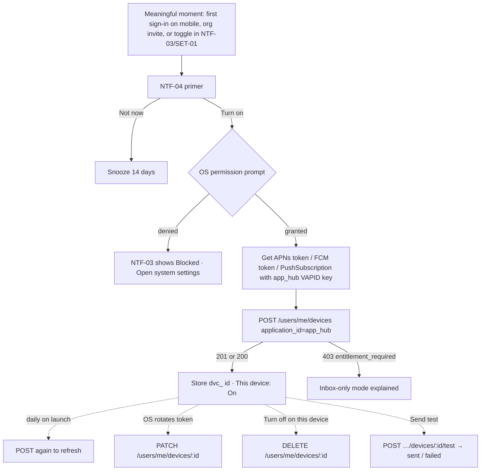

- Windows and Linux skip this flow: notifications come from polling and are shown locally (CLIENT-ARCHITECTURE §6.2).
- Sign-out deactivates the device server-side; signing in again re-registers it under the new session.

## F13 · Receive and act on a notification

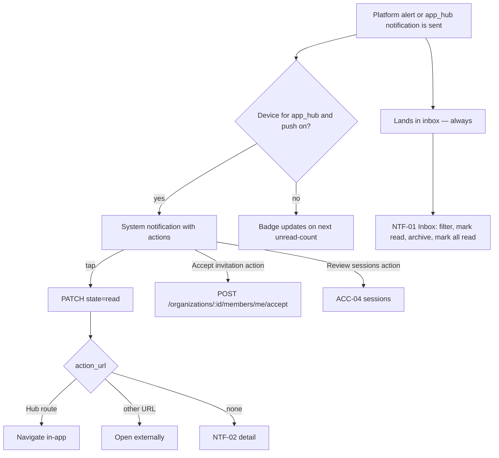

- Foreground pushes become an in-app banner and refresh the inbox; the badge always comes from `unread-count`.
- Other apps' notifications appear in the Hub inbox but push only to those apps' own installs.

## F14 · An organization subscribes to Standard for its members

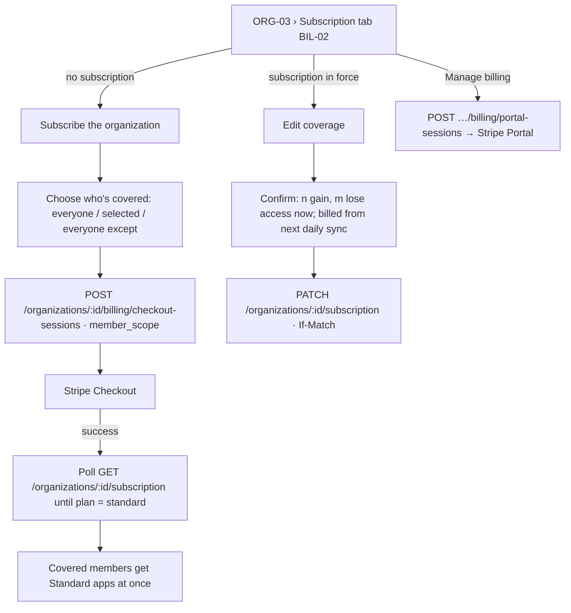

- Billed users = covered active members (`quantity.current`); the invoice uses the daily-synced count (`quantity.last_synced`).
- Removing a member from the org removes their coverage immediately.

## F15 · Developer sets up push for their app

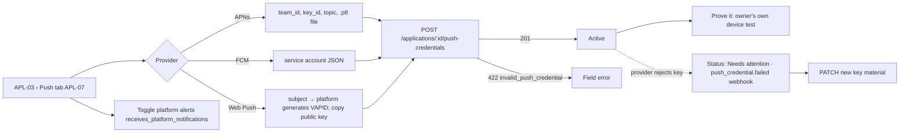

## F16 · Support investigates "I never got the alert"

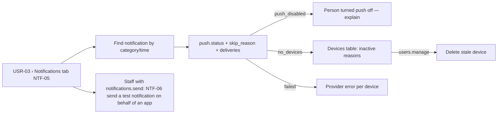

## Cross-cutting behavior

| Situation | Behavior on every platform |
|---|---|
| `401 unauthenticated` mid-session | Try refresh once; on failure, return to Sign in preserving the deep link destination. |
| `403 forbidden` | Inline empty-state "You don't have permission to view this." — never a crash or blank screen. |
| `409 not_unique` / `entitlement_already_exists` | Inline field error or "Already granted — view it" link. |
| `409 version_conflict` (`If-Match` mismatch) | "This changed since you opened it." Reload / Re-apply. |
| `422 validation_failed` | Map `details[].field` to field-level errors. |
| `429 rate_limited` | Disable the action, show retry countdown from `Retry-After`. |
| `503 service_unavailable` | Non-blocking banner; queue nothing — writes are retried manually. |
| `501 not_implemented` | Feature flag off for the session; entry points hidden. |
| Incoming push | Refetch from the API; never trust push content as state. |
| Idempotency | Every create/POST sends an `Idempotency-Key` (UUID v4) generated when the form opens, reused on retry (required on grants and checkouts). |
| Pagination | Cursor based; preserve scroll position on back-navigation. |
| Optimistic updates | Allowed for toggles and role assignment only; everything else waits for server. |
