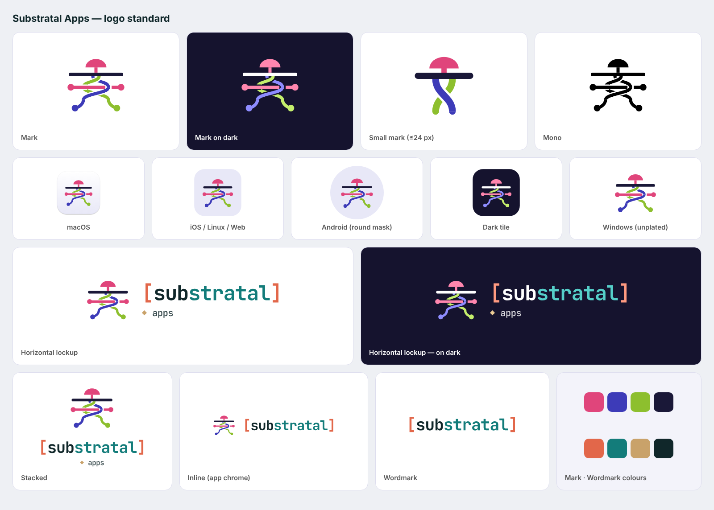

# Substratal Apps — logo standard

The logo is part of the standard for every Hub app. This folder is the **source of truth**. Each platform folder has a `brand-assets/` directory with the files that platform needs, generated from these masters. Don't redraw, re-colour or re-typeset them.



## 1. Concept

A mushroom cap sits above a **ground line**. The visible apps sit above ground; the API grows below as **interlined roots**. Two root strands twist through each other and out to both sides. A **runner** crosses them, and its ends are nodes. Crossings go alternately over and under, so the roots read as one network in both directions.

## 2. Anatomy and colour

| Part | Light (default) | On dark | Role in token file |
|---|---|---|---|
| Cap, stem, runner, runner nodes | `#E0457B` pink | `#FF86AE` | `A` |
| Root strand 1 + node | `#3D3BB8` indigo | `#8E8CFF` | `B` |
| Root strand 2 + node | `#8DBF2E` lime | `#C4EE6C` | `C` |
| Ground line | `#1A1838` ink | `#FFFFFF` | `G` |

The gaps at crossings are **transparent**: they are clip-path cut-outs, not painted background. That means the mark works on any surface.

**Wordmark:** `[substratal]` set in **JetBrains Mono Bold**, tracking −0.03 em, shipped as **outlined paths**. The optional descriptor line is `◆ apps` in JetBrains Mono Medium.

| Wordmark part | Light | On dark |
|---|---|---|
| `[` `]` brackets | `#E2674A` coral | `#FF9A80` |
| `sub` | `#10272A` ink | `#FFFFFF` |
| `stratal` | `#137C7A` teal | `#55CFC9` |
| `◆` | `#C9A26A` sand | `#EBCB95` |
| `apps` | `#10272A` at 85 % | `#FFFFFF` at 85 % |

**Icon surfaces:** tint `#E8E8F7` (light icon background), night `#15132E` (dark icon background and dark tiles), paper `#F3F3FA`.

All values are in `brand-tokens.json`.

## 3. Variants: which to use where

| Variant | File (`svg/`) | Use |
|---|---|---|
| Mark | `mark.svg`, `mark-on-dark.svg` | App icons, avatars for `source: platform` notifications, places with no room for the name |
| Small mark | `mark-small*.svg` | **Required at 24 px and below**: favicons, the Windows title bar, menu-bar/tray, notification small icons, Linux symbolic. It keeps the cap, the ground and one twist, with heavier strokes. |
| Horizontal lockup | `lockup-horizontal*.svg` | Sign-in (AUTH-01), splash/about, marketing, store graphics |
| Inline lockup | `lockup-inline*.svg` | App chrome: the web sidebar header and compact headers. It has no descriptor line. |
| Stacked lockup | `lockup-stacked*.svg` | Launch screens, square spaces, empty-state hero |
| Wordmark | `wordmark*.svg` | Only where the mark already appears nearby |
| Mono | `*-black.svg`, `*-white.svg` | Template images (macOS menu bar), Android themed/monochrome icons, Web Push badge, single-colour print |
| App icon | `app-icon.svg`, `app-icon-dark.svg` | Generic rounded tile. Each platform's own icon is in its `brand-assets/`. |

PNG exports are in `png/`: the mark at 128–1024 px, every lockup at @1x/@2x/@3x, and the app icon tiles at 1024 px.

## 4. Size, clear space, backgrounds

- **Clear space:** ¼ of the mark's height on every side, measured from the cap top to the root nodes. Nothing else enters that space.
- **Minimum size:**
  - Full mark: 32 px. Below that, use the small mark, down to 16 px.
  - Horizontal lockup: 120 px wide.
  - Inline lockup: 20 px tall.
- **Backgrounds:**
  - Light variants on white, paper, tint or any surface lighter than 75 % L\*.
  - On-dark variants on night, ink or any surface darker than 35 % L\*.
  - Mono in between, or on photos.
- **Icon layout:**
  - The mark fills about **76 % of the tile**.
  - It is optically centred, nudged down 1 % so the cap doesn't feel top-heavy.
  - Android adaptive icons keep the mark inside the 66 dp safe circle (scale 0.94 on a 108 dp canvas).
  - Web maskable icons use 64 % so the mark stays inside the 80 % safe zone.

## 5. Don'ts

- Don't recolour individual parts, swap the strand colours, or render the mark in the wordmark's palette.
- Don't fill the crossing gaps or add outlines, shadows, gradients or glows. The only exceptions are the platform icon treatments in `brand-assets/` (the macOS body, Liquid Glass layers).
- Don't re-set the wordmark in live text or another font, or drop the brackets.
- Don't use the full mark below 32 px. Don't place the light mark on dark surfaces or the reverse.
- Don't add "Hub" to the logo. The product is named **Substratal** in UI chrome, and the logo's accessible name is **"Substratal Apps"**.

## 6. Where the logo appears in the Hub (all platforms)

| Place | Asset | Notes |
|---|---|---|
| App icon (launcher, Dock, taskbar, Start, store) | platform `brand-assets/` | iOS/macOS include dark and tinted appearances; Android includes an adaptive and themed monochrome icon; Windows has plated and unplated versions for the light and dark taskbar. |
| Sign-in and 2FA (AUTH-01/02) | Horizontal lockup above the form | `role="img"` / accessibility label "Substratal Apps". Developer builds: long-pressing the lockup reveals the test-mode toggle (SCREEN-SPECS AUTH-01). |
| Launch / splash | Stacked lockup or mark on the icon surface | iOS `UILaunchScreen`, Android `SplashScreen` API, Windows MSIX splash, PWA manifest colours. |
| Web sidebar header | Inline lockup, 24 px tall | Collapsed sidebar shows the small mark only. |
| Windows title bar | Small mark, 16 px, followed by the text "Substratal" | `AppWindow.SetIcon("Substratal.ico")`. Use `Substratal-dark.ico` when the title bar is dark. |
| macOS menu-bar extra (optional) | `MenuBarIcon` template image | Black small mark; the system tints it. |
| Notifications (system) | App icon (large), small mark (Android small icon / Web Push badge) | `ic_stat_substratal`, `badge-96.png` |
| Inbox rows / detail for `source: platform` | App icon tile | Treat as decorative; the row already reads "Substratal". |
| About / Settings › About | Horizontal lockup + version | |
| macOS/GNOME window titles, sidebars | **No logo.** Text title only, per HIG | |

## 7. Files

```
brand/
├── BRAND.md · brand-tokens.json · logo-standard.png
├── svg/   mark, mark-small, lockup-horizontal, lockup-inline, lockup-stacked, wordmark
│          × {light, -on-dark, -black, -white}; app-icon.svg, app-icon-dark.svg
└── png/   mark{,-on-dark}-{128,256,512,1024}.png · <lockup>{,-on-dark}@{1,2,3}x.png · app-icon{,-dark}-1024.png
```

Platform kits: `ios/brand-assets`, `macos/brand-assets`, `windows/brand-assets`, `android/brand-assets`, `linux/brand-assets`, `web/brand-assets`. Each `PLATFORM-SPEC.md` has a "Brand & app icon" section explaining how to wire them in.
